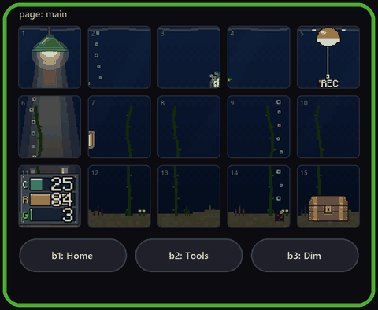

# m18-pad

A macro pad your coding agents can use.

`m18d` is a small Python daemon for the VSDinside VSD M18 (15 LCD keys, 3 buttons, a 24-LED ring).
It replaces the vendor app with one YAML file, and it ships as an agent skill, so Claude Code or
Codex can add keys for you: "make a key that mutes Discord".

Agent sessions get the pad too. Each session can show its state on its own key, draw its own
16x16 face, and put up a physical go/stop button that you press with a finger.

Unofficial. Not affiliated with or endorsed by VSDinside or Mirabox.



**[Try the pad in your browser](https://handoffandhope.github.io/m18-pad/)**: the real scene code, live, with sliders for the signals.

## Gallery: pages built by agents

Every picture here was recorded from the mock pad with `m18ctl record`. The frame, key numbers and
button labels come from the preview; on the real pad you see only the 15 screens.

| | |
|---|---|
|  | **Fish bowl.** One tank seen through 15 windows. Each creature is a running agent session, and it swims to the glass when it needs you. The lamp, buoy, filter and chest are working keys. |
|  | **City.** Windows light up with CPU load, the moon crosses the sky through the day, traffic follows network activity, and it rains above 80% memory use. Claude Haiku 5.5 built it in under three minutes from one paragraph and a one-page manual: [prompt, scene file and cost](gallery/city/). |

## Design a page with a small model

A scene is one Python file with a `draw` function. The daemon feeds it live numbers as named
signals (`cpu`, `ram`, `net`, `time_of_day`, your own) and does the rest: the frame loop, cutting
the picture into 15 keys, previews, reload on save, the LED ring.

```python
SIGNALS = ["cpu"]

def draw(im, d, s, t, state):
    d.rectangle((0, 0, 440, 252), fill="#0b1026")
    r = 20 + 80 * s.cpu.value
    d.ellipse((220 - r, 126 - r, 220 + r, 126 + r), fill="#4cc9f0")
```

[references/scene-card.md](references/scene-card.md) is the whole manual and fits on one page, so a
cheap model can design a page without reading the rest of the skill. `m18ctl scene shot NAME --set
cpu=0.9` renders a scene to a PNG with no daemon and no pad. Numbers that are specific to your PC
(unread mail, a build, a thermostat) are one small file each in `signals/`; set them up once with a
stronger model and every scene can use them by name.

A signal can also carry a list. The fish bowl is built this way: the `agents` signal lists the
running sessions, `claude_usage` gives the water level, and
[scenes/fishbowl.py](scripts/m18/scenes/fishbowl.py) is 130 lines that hand both to the tank engine.
Put it on a page with `tank: {scene: {name: fishbowl, hold: true, fixtures: {1: lamp, 15: chest}}}`.
The plugin page (`mode: fishbowl`) still does more: agents' posts on their creatures, the card count
on the chest and night while you are away.

Made something? Record it and open a pull request:

```powershell
m18ctl start --mock
m18ctl record gallery\mypage.gif --page mypage --seconds 6
```

## What it does

- **One config file.** `macros.yaml` sets what every key shows and does. The daemon reloads it on save.
- **Live keys.** Plugins in plain Python draw a key every second or so: CPU and GPU, an app volume mixer,
  the clipboard, OBS replay clips, Discord mute.
- **Agent keys.** `pad status`, `pad progress`, `pad face`, `pad flash`, `pad button`, `pad wait`
  (see [references/agents.md](references/agents.md)).
- **Session views.** Running Claude Code and Codex sessions as keys, or as creatures in a fish bowl
  that swim to the glass when one needs you.
- **Themes.** Three scenes painted across all 15 keys: hillside, vaporjazz, wabisabi
  (see [aesthetics/](aesthetics/README.md)).
- **The LED ring** as a meter, a progress bar or an alert.

## No pad needed: mock mode

The daemon runs without hardware, which is how agents test their own keys:

```powershell
m18ctl start --mock      # everything except USB; keystrokes are logged, not sent
m18ctl press 3           # press key 3
m18ctl preview --all     # PNG of every page, as the pad would show it
m18ctl dryrun 3          # press a key on a throwaway mock, without touching a running daemon
m18ctl record out.gif    # GIF of the running page
```

`scripts/m18/e2e_check.py` drives a mock daemon end to end and prints PASS or FAIL per check.

## Install (Windows)

Requirements: Windows 10 or 11, Python 3.11+, git. The code uses Windows APIs for keystrokes, audio and
window focus, so it does not run on macOS or Linux as written.

```powershell
git clone <this repo> $env:USERPROFILE\.agents\skills\m18-macropad
powershell -ExecutionPolicy Bypass -File $env:USERPROFILE\.agents\skills\m18-macropad\scripts\setup.ps1
```

Setup copies the daemon to `%USERPROFILE%\tools\m18`, makes a venv, and clones VSDinside's official
SDK next to it. Then quit VSD Craft (only one program can own the pad) and run:

```powershell
& $env:USERPROFILE\tools\m18\m18ctl.cmd doctor
& $env:USERPROFILE\tools\m18\m18ctl.cmd start
& $env:USERPROFILE\tools\m18\m18ctl.cmd identify
```

`identify` shows each key's number. If presses land on the wrong row, add a `settings.key_map`
([references/setup.md](references/setup.md) has the one that was needed on the development unit).

To let Claude Code see the skill:

```powershell
New-Item -ItemType Junction -Path $env:USERPROFILE\.claude\skills\m18-macropad -Target $env:USERPROFILE\.agents\skills\m18-macropad
```

## Safety and limits

- The pad keeps its stock firmware. The daemon talks to it only through the vendor SDK and never
  writes the boot logo, which is stored in device ROM.
- Developed on one unit and one firmware version. Key order and LED order may differ on yours;
  `m18ctl identify` and `m18ctl ringtest` show what your unit does.
- The control API listens on localhost only.
- Optional parts need their own setup: Discord (a developer app), OBS (websocket), the Chrome
  stale-tabs extension, and Decisions API labelling for sessions (`M18_SESSIONS_DECISIONS=off`
  runs without it).

## Credits

- [VSDinside Plugin SDK](https://github.com/VSDinside/VSDinside-Plugin-SDK) (MIT), fetched by setup, not bundled.
- [bidoofgoo/streamdock-m18](https://github.com/bidoofgoo/streamdock-m18) for community findings on the
  LED ring and key ids.
- [Material Design Icons](https://pictogrammers.com/library/mdi/) by Pictogrammers; licence in
  `scripts/m18/assets/MDI-LICENSE.txt`.

## Licence

MIT, see [LICENSE](LICENSE).
