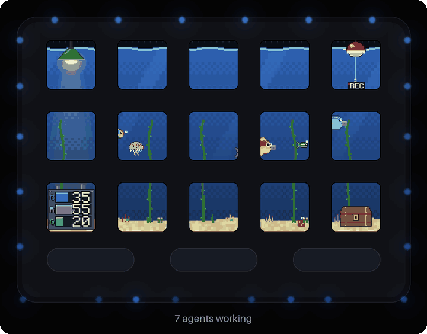
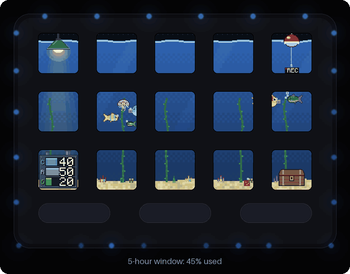
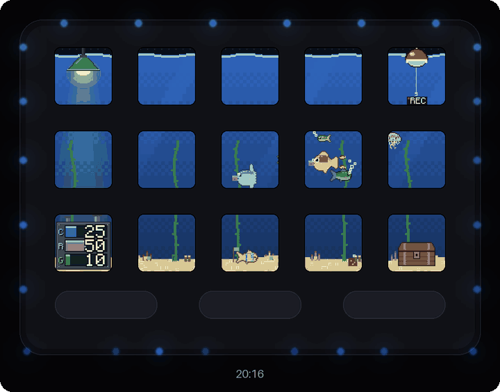
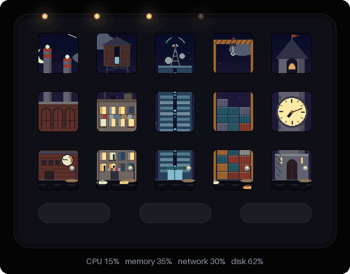
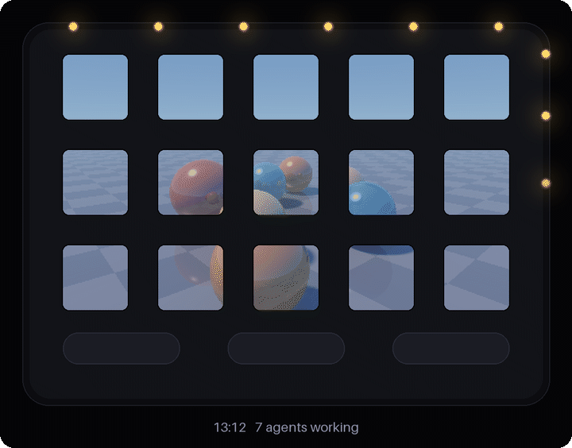
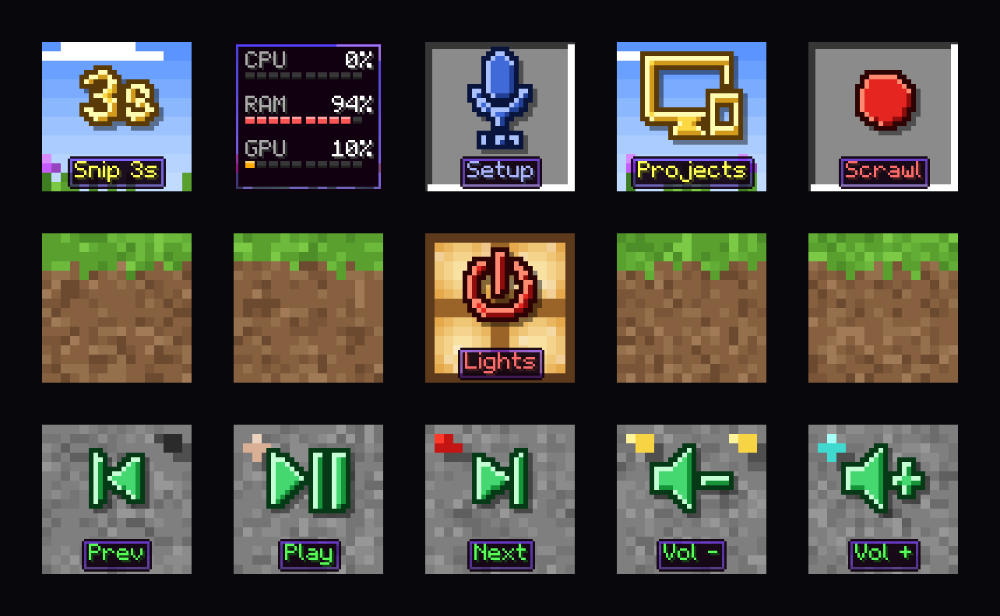
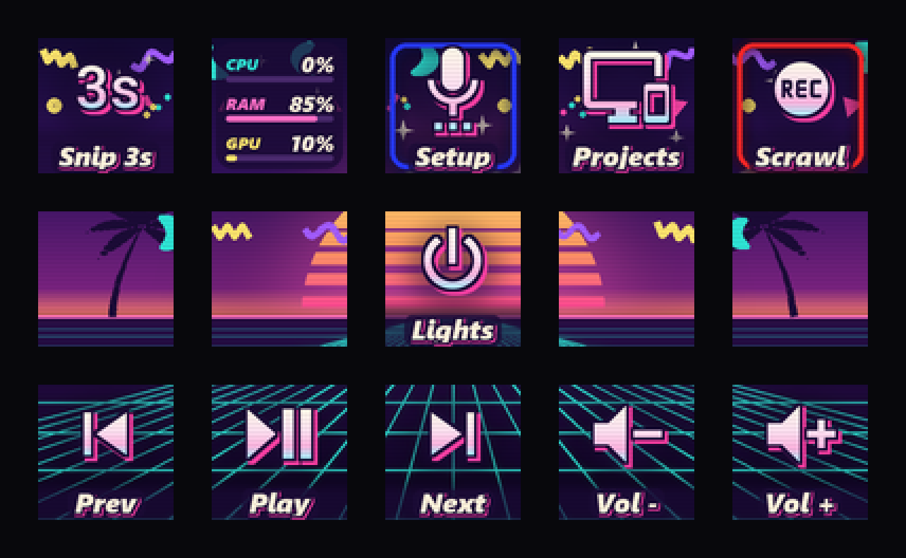
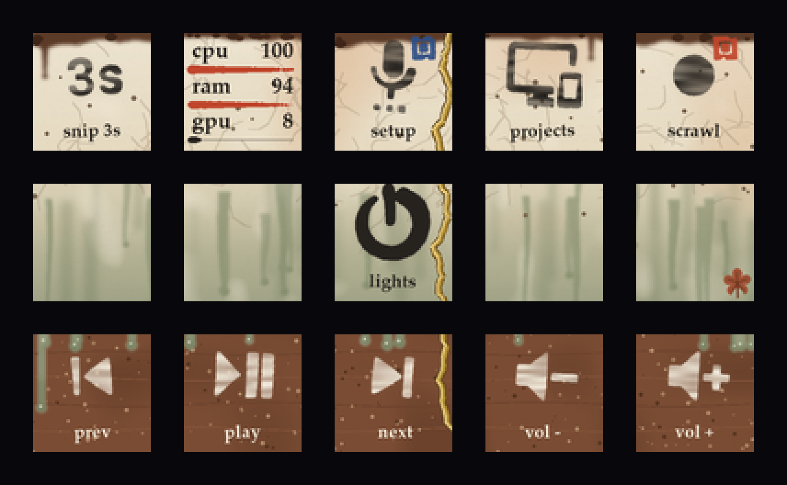

# m18-pad

Fifteen small screens under your monitor that show what your AI agents are doing. It runs on a
VSD M18 macro pad: 15 LCD keys, 3 buttons and a ring of 24 lights.



Every creature in this tank is a running Claude Code or Codex session. While they work, they swim.
When one stops to ask you something it comes up to the glass with a `?` over its head, and the ring
of lights round the pad breathes gold until you answer. Tap the creature and it tells you which
session it is. Tap again and that session's window opens.

**[Play with it in your browser](https://handoffandhope.github.io/m18-pad/)**. It is the same code
that runs on the pad, with sliders for everything it reacts to.

## The water is your usage limit



The waterline falls as your 5-hour Claude window fills up. When you hit the limit the tank freezes,
creatures and all, and the ice thins as the reset gets closer.

## At nine the lights go out



After 21:00 the tank goes dark and the lamp in the corner is what is left. The creatures glow
faintly, so you can still see who is moving.

## A city through the window



The fifteen screens are panes of one window and the bars between them are its glazing bars. Nothing is
lined up with them. You look down an avenue from a few floors up, and buildings, cars and smoke pass
behind the bars the way they do behind a real window.

The view is your computer. The power plant across the street is the CPU: its furnace windows glow
hotter, the chimneys smoke harder, the cooling tower steams. Memory is the water tank on the roof next
door, and when it runs tight it rains and the drops run down the glass, pane by pane. Network is the
traffic on the avenue. Disk is the container yard below, where the stacks grow. The clock tower at the
end of the avenue keeps the time, and pigeons leave it on the hour.

A cat sits on the sill and watches the street. Tap a pane and it shows the number of what you see in it.

Claude Haiku 5.5 wrote the first version of this city in under three minutes from one paragraph and
a one-page manual. The [prompt, the file it wrote and what it cost](gallery/city/) are all here.

## It does not have to be pixel art



This one is ray traced: real shadows, reflections in the floor, a sun that sets. Each agent session
is a marble with a key of its own, so a tap on a key is a tap on that session. The bars between the
screens work as a window frame: the shadows run behind them into the next key. The one with a
question lifts off the floor and becomes a lamp for the rest, and at night they all glow. It is
[110 lines](scripts/m18/scenes/marbles.py) on top of a small 3D helper, so a scene you ask for can
be 3D too.

## Or one quiet picture across every key

| hillside | vaporjazz | wabisabi |
|---|---|---|
|  |  |  |

Three themes paint all 15 keys as one scene and keep your shortcuts on top of it
([aesthetics/](aesthetics/README.md)).

## The agents get the pad too

A session can put its state on its own key, draw its own 16x16 face there, and put up a real go/stop
button that you press with a finger: "deploy?" lights up, you press it, the agent carries on
([references/agents.md](references/agents.md)). And because the whole thing ships as an agent skill,
you add keys by asking: "make a key that mutes Discord".

## What this is

`m18d` is a small Python daemon for the VSDinside VSD M18, a macro pad with 15 LCD keys, 3 buttons
and a ring of 24 LEDs. It replaces the vendor app with one YAML file. You need the pad, Windows and
Python; without the pad, everything above still runs in the [browser](https://handoffandhope.github.io/m18-pad/)
and in mock mode.

The clips on this page are the real scene code drawn onto a picture of the pad by
[gallery/film.py](gallery/film.py), with scripted agents and a scripted clock. The names in the tank
are made up.

Unofficial. Not affiliated with or endorsed by VSDinside or Mirabox.

## Design a page with a small model

A scene is one Python file with a `draw` function. The daemon feeds it live numbers as named
signals (`cpu`, `ram`, `net`, `time_of_day`, your own) and does the rest: the frame loop, cutting
the picture into 15 keys, previews, reload on save, the LED ring.

```python
SIGNALS = ["cpu"]

def draw(im, d, s, t, state):
    d.rectangle((0, 0, 440, 252), fill="#0b1026")
    r = 20 + 80 * s.cpu.value
    d.ellipse((220 - r, 126 - r, 220 + r, 126 + r), fill="#4cc9f0")
```

[references/scene-card.md](references/scene-card.md) is the whole manual and fits on one page, so a
cheap model can design a page without reading the rest of the skill. `m18ctl scene shot NAME --set
cpu=0.9` renders a scene to a PNG with no daemon and no pad. Numbers that are specific to your PC
(unread mail, a build, a thermostat) are one small file each in `signals/`; set them up once with a
stronger model and every scene can use them by name.

A signal can also carry a list. The fish bowl is built this way: the `agents` signal lists the
running sessions, `claude_usage` gives the water level, and
[scenes/fishbowl.py](scripts/m18/scenes/fishbowl.py) is 130 lines that hand both to the tank engine.
Put it on a page with `tank: {scene: {name: fishbowl, hold: true, fixtures: {1: lamp, 15: chest}}}`.
The plugin page (`mode: fishbowl`) still does more: agents' posts on their creatures, the card count
on the chest and night while you are away.

Made something? Record it and open a pull request:

```powershell
m18ctl start --mock
m18ctl record gallery\mypage.gif --page mypage --seconds 6
```

## What it does

- **One config file.** `macros.yaml` sets what every key shows and does. The daemon reloads it on save.
- **Live keys.** Plugins in plain Python draw a key every second or so: CPU and GPU, an app volume mixer,
  the clipboard, OBS replay clips, Discord mute.
- **Agent keys.** `pad status`, `pad progress`, `pad face`, `pad flash`, `pad button`, `pad wait`
  (see [references/agents.md](references/agents.md)).
- **Session views.** Running Claude Code and Codex sessions as keys, or as creatures in a fish bowl
  that swim to the glass when one needs you.
- **Themes.** Three scenes painted across all 15 keys: hillside, vaporjazz, wabisabi
  (see [aesthetics/](aesthetics/README.md)).
- **The LED ring** as a meter, a progress bar or an alert.

## No pad needed: mock mode

The daemon runs without hardware, which is how agents test their own keys:

```powershell
m18ctl start --mock      # everything except USB; keystrokes are logged, not sent
m18ctl press 3           # press key 3
m18ctl preview --all     # PNG of every page, as the pad would show it
m18ctl dryrun 3          # press a key on a throwaway mock, without touching a running daemon
m18ctl record out.gif    # GIF of the running page
```

`scripts/m18/e2e_check.py` drives a mock daemon end to end and prints PASS or FAIL per check.

## Install (Windows)

Requirements: Windows 10 or 11, Python 3.11+, git. The code uses Windows APIs for keystrokes, audio and
window focus, so it does not run on macOS or Linux as written.

```powershell
git clone <this repo> $env:USERPROFILE\.agents\skills\m18-macropad
powershell -ExecutionPolicy Bypass -File $env:USERPROFILE\.agents\skills\m18-macropad\scripts\setup.ps1
```

Setup copies the daemon to `%USERPROFILE%\tools\m18`, makes a venv, and clones VSDinside's official
SDK next to it. Then quit VSD Craft (only one program can own the pad) and run:

```powershell
& $env:USERPROFILE\tools\m18\m18ctl.cmd doctor
& $env:USERPROFILE\tools\m18\m18ctl.cmd start
& $env:USERPROFILE\tools\m18\m18ctl.cmd identify
```

`identify` shows each key's number. If presses land on the wrong row, add a `settings.key_map`
([references/setup.md](references/setup.md) has the one that was needed on the development unit).

To let Claude Code see the skill:

```powershell
New-Item -ItemType Junction -Path $env:USERPROFILE\.claude\skills\m18-macropad -Target $env:USERPROFILE\.agents\skills\m18-macropad
```

## Safety and limits

- The pad keeps its stock firmware. The daemon talks to it only through the vendor SDK and never
  writes the boot logo, which is stored in device ROM.
- Developed on one unit and one firmware version. Key order and LED order may differ on yours;
  `m18ctl identify` and `m18ctl ringtest` show what your unit does.
- The control API listens on localhost only.
- Optional parts need their own setup: Discord (a developer app), OBS (websocket), the Chrome
  stale-tabs extension, and Decisions API labelling for sessions (`M18_SESSIONS_DECISIONS=off`
  runs without it).

## Credits

- [VSDinside Plugin SDK](https://github.com/VSDinside/VSDinside-Plugin-SDK) (MIT), fetched by setup, not bundled.
- [bidoofgoo/streamdock-m18](https://github.com/bidoofgoo/streamdock-m18) for community findings on the
  LED ring and key ids.
- [Material Design Icons](https://pictogrammers.com/library/mdi/) by Pictogrammers; licence in
  `scripts/m18/assets/MDI-LICENSE.txt`.

## Licence

MIT, see [LICENSE](LICENSE).
