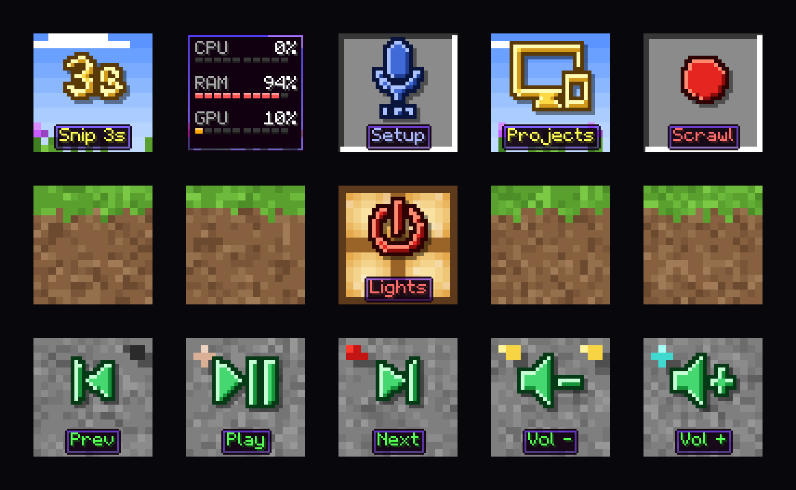

# HILLSIDE: "Cross-section of a hillside"

An original blocky-world theme. Every texture, the 5x7 font and the item look are drawn in
`theme.py` from scratch. Don't add textures, fonts or sounds taken from any game's files.

**Mood:** you dug a tunnel into the side of a hill and you're looking at the wall. The pad shows
three layers of one blocky world, each key exactly one block (16 texels, 4 LCD px each).

## The pad as one slice
- **Top row (sky):** banded blue sky, flat two-tone clouds along the top edge, a square sun
  peeking into key 5's corner, grass tufts and little flowers along the bottom edge (they show
  beside the label tooltips).
- **Middle row (grass blocks):** grass on top with dripping edge pixels, dirt below. The center
  key (8, Lights) is a **lit redstone lamp**, because it turns the lights off.
- **Bottom row (stone):** stone with dark cracks, and an ore per key in its corners: coal, iron,
  redstone, gold, diamond (keys 11-15), as one or two compact clusters in the top corners.

## Icons are items
- Every `mdi:` icon is pixelated onto a 32x32 grid (2 LCD px per cell) and painted as an item: a
  dark outline, a highlight on top/left edges, shade on bottom/right, a soft drop shadow.
- Material by row: **gold** in the sky, **diamond** on grass, **emerald** on stone, **redstone**
  on the lamp. `material: iron` (or any material) forces one material everywhere.
- Pick icons with bold, simple silhouettes. Thin-line or text-like icons (`record-rec` shows
  "REC", now drawn as a plain disc) turn into mush at 32 cells.
- Big text (`glyph`, like `3s`) uses the pixel font scaled 2-3x, painted as an item.

## Labels are tooltips
- 5x7 pixel font, one LCD pixel per font pixel, with a shadow at a quarter of the text colour.
- A dark plum tooltip box with a purple inner border and notched corners.
- Text colour is the item's rarity: gold → yellow `#ffff55`, diamond → aqua `#55ffff`,
  emerald → green `#55ff55`, redstone → `#ff5555`, iron → white, lapis → `#aab4ff`,
  amethyst → `#ff55ff`.
- About 9 characters fit. Longer labels are cut.

## Status colour
A face's `bg` turns the key into an **inventory slot**: flat grey `#8b8b8b` with a dark top-left
and white bottom-right bevel. The item in it takes the nearest material by hue (red → redstone,
green → emerald, blue → lapis, yellow → gold, cyan → diamond, purple → amethyst, grey → iron), and
so does the label. A slot breaks the scene on purpose, so use it for state only.
Lettered discs (`mdi:record-rec`) are drawn as a plain disc, because letters don't survive 32 cells.

## Plugins
Return `ctx.theme_fn("meters")(rows, key=ctx.key)` for stats: a tooltip plate, pixel names and
values, and 10-pip bars (CPU XP-green, RAM aqua, GPU orange, red at 85% or more). For other
custom tiles, draw at 64x64 on whole pixels, upscale x3 with NEAREST, and return RGBA. The theme
module also offers `draw_text(img, x, y, text, colour, scale=1)` and `text_width(text)`.

## Palette
| Role | Hex |
|---|---|
| Sky bands | `#5b93ff` → `#c0dbff` |
| Grass | `#4e8e28` `#5aa02f` `#6cb93c` `#7bc945` |
| Dirt | `#6b4a30` `#7a5537` `#86603f` `#95704d` |
| Stone | `#6c6c6c` → `#979797` |
| Tooltip | `#100010`, border `#5000ff` → `#28007f` |
| Ring LED | `#4caf2a` (grass) |

## Options
`settings.theme: {name: hillside, clouds: true, flowers: true, ores: true, lamp: true, material: null}`

## Don't
- No anti-aliasing: everything sits on whole LCD pixels (`RESAMPLE = Image.BOX`).
- No characters or creatures: blocks, items and UI only.
- No textures or fonts lifted from any game.
