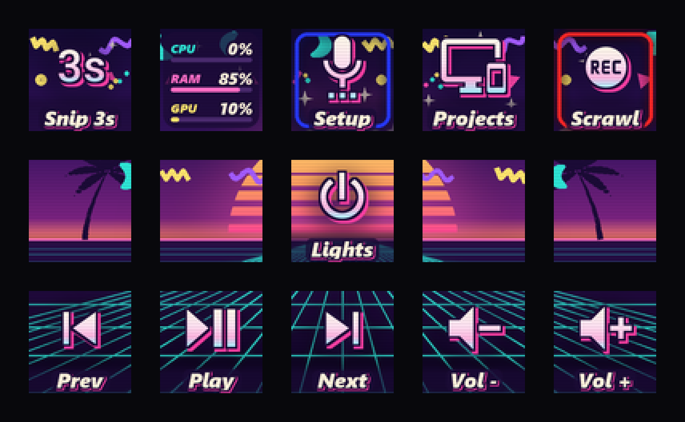

# VAPORJAZZ: "Late Night Mall, 1994"

**Mood:** the food court is closing and the sky over the parking lot is doing the thing. Paper cup
confetti, a VHS that has been rewound too many times, a sunset that only exists on a screensaver.
Nostalgic, warm, a bit cheesy on purpose, never grimy.

**Inspiration (genre, not copies):** early-90s "jazz" print graphics (teal brush swashes and purple
squiggles on white paper cups and arcade carpets), Memphis Group shapes (zigzags, triangles,
rings, terrazzo specks), vaporwave and outrun sunsets (striped sun, perspective neon grid, palm
silhouettes), and 90s sticker graphics (pastel chrome fills, thick outlines, hard drop shadows).

## The pad as one scene
The 15 keys are a single window, sliced with virtual bezels so lines stay continuous:
- **Top row (sky):** indigo-to-magenta dusk with jazz confetti in the key corners and sparkles.
- **Middle row (horizon):** a striped sun sets behind the **center key** (key 8, power), with
  palm silhouettes on keys 6 and 10. The horizon is a hot-pink line low in the row.
- **Bottom row (floor):** a teal perspective grid on deep purple.

Where a key sits decides its background. Put calm, frequent controls on the floor (media), and
let the middle row stay mostly scene.

## Palette
| Role | Hex |
|---|---|
| Ink (outlines, tags, palms) | `#1b0b36` |
| Cream (icon top, label text) | `#fff4dc` |
| Hot-pink shadow | `#ff3fa4` |
| Teal (grid, swashes, "good") | `#2ee6d6` |
| Pink accent | `#ff6ec7` / `#ff46aa` |
| Purple squiggle | `#a45cff` |
| Yellow (zigzags, rings) | `#ffe66d` |
| Peach (warn) | `#ffb38a` |
| Bad / alert | `#ff3f6c` |
| Ring LED | `#ff4fa0` |
Icon fill gradient, top to bottom: `#fffbea` → `#ffe3f3` → `#ffb6e1` → `#a9f4ff`.

## Icons, glyphs, labels
- Icons are stickers: chrome-pastel gradient fill, a 2 px ink outline at 64 px, and a hard pink
  drop shadow down-right. Use `mdi:` icons with simple, chunky silhouettes. Thin-line icons lose
  their shape under the outline.
- Big text (`glyph`, like `3s`) gets the same sticker treatment in Segoe UI Black Italic.
- Labels: Segoe UI Black Italic, cream, on a dark ink tag. Title Case, ≤ 8 characters
  ("Setup", not "setup").
- Don't set `fg` per key: the theme's gradient is the identity. Meaning goes in the icon, the label
  and the rim.

## Status color
A key's `bg` becomes a neon rim (full saturation, glowing) drawn under the ink, so red = recording
and blue = Discord still read without breaking the scene. Use it for state only, on at most 2-3
keys per page.

## Plugins drawing their own tiles
Read `ctx.theme` (the PALETTE) and return an **RGBA** image with a transparent background, so the
scene shows through. Put text on a translucent ink plate (`ink + "c8"`), and use `PALETTE["font"]`
with a thick ink stroke. Accents in order are teal, pink, yellow, peach, switching to `bad` when
something is critical. `plugins/sysstats.py` (`_themed`) is the reference.

## Motion (optional, use sparingly)
Animation fits the look (VHS flicker, a slow sun pulse, a grid scrolling toward you), but no more
than one moving key per page. Build it with plugin `frames` (see `plugins/anim.py`) drawn on a
transparent background over the scene.

## Options
`settings.theme: {name: vaporjazz, confetti: true, palms: true, scanlines: true, halo: true}`.
`halo` is the soft dark pool behind icons for legibility over the sun.

## Don't
- Don't put confetti in the icon zone or on the center key. Keep it to corners, fat and saturated.
- No thin strokes, gradients behind small text, or label text without its tag.
- No real brand art or logos (no specific cup design); the jazz shapes are generic.
- Not grimy or glitchy: it's nostalgic and clean, closer to a mall poster than to glitch art.
