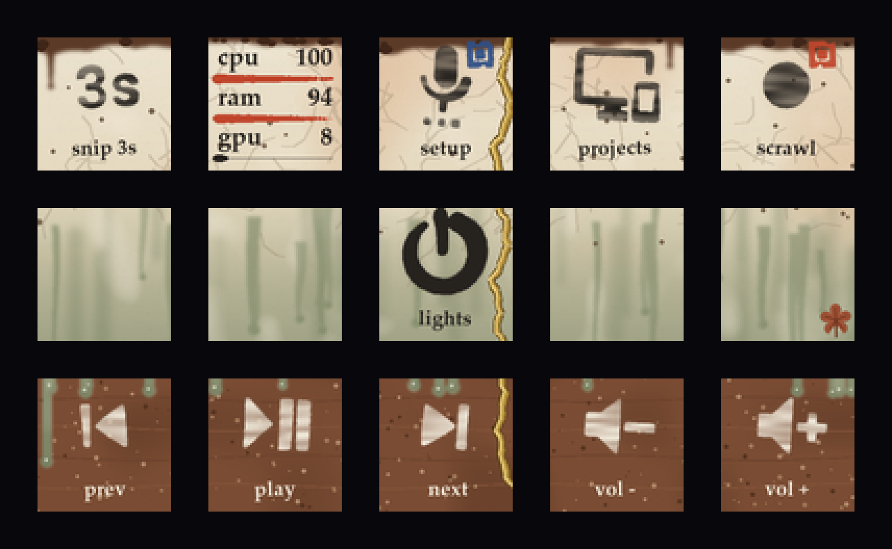

# WABI-SABI: "The mended tea bowl" (侘寂)

**Idea:** the pad is the side of one hand-thrown tea bowl, seen up close. Wabi-sabi finds beauty in
what is imperfect, impermanent and incomplete, so every rule here follows from one of those three:

| Principle | How it shows on the pad |
|---|---|
| **Imperfect** (fukinsei, asymmetry) | No key is quite straight: each icon is rotated and offset a little, by a seed fixed per key. Ink edges bleed and the ink thins where the brush ran dry. Labels sit a touch off true. |
| **Impermanent** (mujo) | A seasonal accent, picked when the theme loads: a fallen maple leaf in autumn, plum petals in spring, moss in summer, snow on the lip in winter. It sits on one empty key and quietly goes when that key gets a function. |
| **Incomplete** (the enso) | The power key is an enso: a brushed circle left open at the top, its one stroke the power symbol's line. |
| **The flaw is valued** (kintsugi) | One break, mended with gold, runs from the lip down the right margins of keys 3, 8 and 13 as one continuous seam. |
| **Simple, quiet** (kanso, shibui) | No plates or boxes. Lowercase serif labels. Status is a small hand-stamped seal, not a coloured key. Empty keys stay empty glaze (ma). |
| **Natural** (shizen) | Every colour is a glaze, clay or pigment: shino cream, ash green, iron rim, raw clay, sumi, gofun white, vermilion, indigo, moss, persimmon. |

## The bowl
- **Top row, the lip:** an iron-brown rim whose thickness wanders from 2 to 8 px, with two iron
  runs into the cream shino glaze below it (fire blush, fine crackle and pinholes).
- **Middle row, the ash glaze:** it turns grey-green and runs down in tapering runs that end in
  beads, where the glaze stopped.
- **Bottom row, the foot:** bare warm clay with grit and faint throwing rings. The glaze stops in
  rounded drips along the top, with one long run down key 11.

## Ink
- Icons and glyphs: sumi ink `#26221e` where the glaze is light, white slip `#f1eadb` on dark
  clay. The theme picks per key from the ground's brightness under the icon. Don't set `fg`.
- Every icon is brushed: a 2.5-5.5° lean and a few pixels of offset per key, strokes that swell
  and thin with brush pressure, roughened edges, dry-brush streaks, and a faint bleed halo.
  Lettered discs (`mdi:record-rec`) become one solid ink dot.
- Labels: Palatino Bold (Zapf's calligraphic roman, with lining figures) in lowercase, ink coloured
  like the icon, never boxed. About 12 characters fit.
- Pick calm `mdi:` icons with solid shapes. Busy or very thin icons fall apart under the rough edge.

## Status: the seal
A face's `bg` becomes a hanko seal stamped in the top-right corner: vermilion for red, indigo for
blue, moss for green, kincha for yellow, sumi for grey. Keep it for real state (recording, muted).

## Plugins
`ctx.theme_fn("meters")(rows, key=ctx.key)` draws stats as brush strokes: lowercase names and
numbers (large enough to read), and an ink stroke for the part used. The stroke has a minimum
length so 0% still shows a dab, and turns vermilion at 85%. For other tiles, return RGBA with no plate, ink in `PALETTE["ink"]` or `PALETTE["slip"]`
(match the ground), text in `PALETTE["font"]`.

## Palette
| Role | Hex |
|---|---|
| Shino cream | `#ece3cf` |
| Fire blush | `#d79d70` |
| Ash glaze | `#a2a487` / runs `#6f7a5b` |
| Iron rim | `#5b3a27` |
| Clay | `#7a4c33` |
| Sumi ink | `#26221e` |
| Gofun white | `#f1eadb` |
| Kintsugi gold | `#c9a24a`, light `#f2dc9a` |
| Shu (vermilion) | `#c0462c` |
| Ai (indigo) | `#2f4f86` |
| Moss | `#5f7a3c` |
| Kaki (persimmon), ring LED | `#c4682f` |

## Options
`settings.theme: {name: wabisabi, kintsugi: true, crackle: true, season: auto, accent_key: 10, grain: true}`.
Set the ring to `#c4682f` at low brightness (about 30); a bright ring fights the quiet.

## Don't
- No perfect symmetry, no glossy gradients, no neon, no boxes behind labels.
- Don't add decoration to fill empty keys: the emptiness is part of the look.
- Don't route the gold seam through an icon's area. It belongs to the margins.
